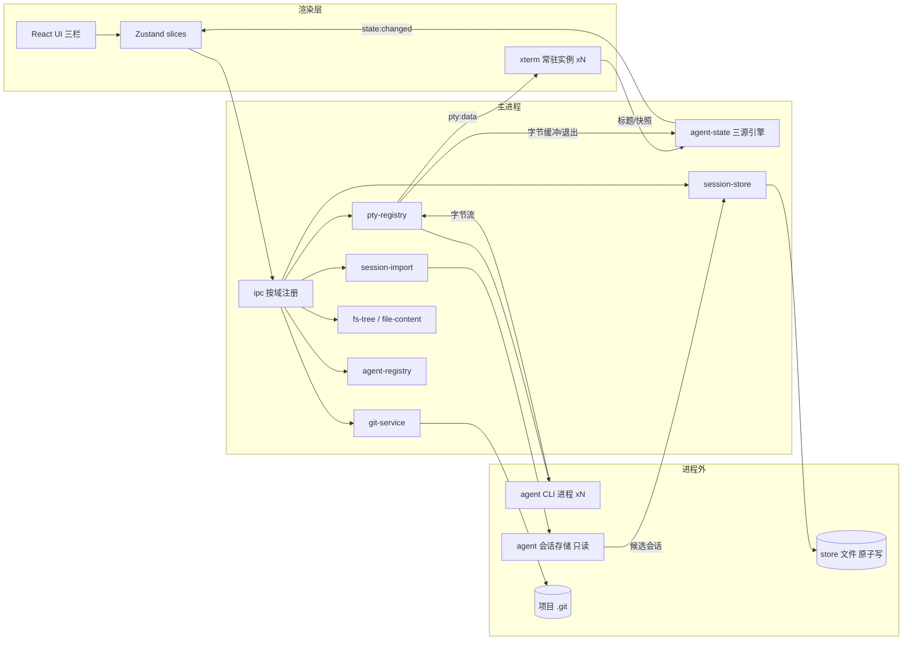

# Agent Sessions · 技术规格

## 整体实现

Electron 单窗口单进程桌面应用:主进程独占全部 Node 能力,渲染层纯 UI,进程间走类型化契约桥;agent 接入用配置驱动的定义表,新增 agent 零框架改动;状态识别走「标题事件 + 屏幕快照 + 字节流缓冲」三源;终端容器用每会话常驻 xterm 实例;持久化用应用数据目录的单个 store 文件整文件原子写。数据主干:用户添加项目目录 → 项目与会话记录写入应用数据目录的单个 store 文件(原子写)→ 新建会话时主进程 spawn 常驻 shell 的 node-pty(PTY=shell 底座,ADR-0004)、把 agent 启动命令注入 shell、把字节流推给渲染层对应 xterm;CLI 退出后回 shell 提示符,标签页保留可继续交互 → 状态识别引擎在主进程消费同一份数据流(标题事件、屏幕快照、字节缓冲)产出会话状态 → 渲染层状态点与通知消费状态变化。会话导入是另一条只读数据流:按 agent 定义定位其存储目录、解析会话元数据、按项目目录匹配、去重后并入 store(删除记录不登记忽略项,故再次导入会重新入库)。应用退出时主进程全量杀掉 PTY,不留孤儿。
## 流程图



## 数据结构

```ts
// src/shared/types.ts
type AgentId = 'claude' | 'codex' | 'antigravity' | 'pi' | 'kimi'
type SessionId = string
type ProjectId = string

interface Project {
  id: ProjectId
  path: string            // 绝对路径,归一化存储
  name: string            // 目录名
}

interface Session {
  id: SessionId
  projectId: ProjectId
  agentId: AgentId
  title: string                       // 应用侧显示名(重命名只改这里)
  externalTitle?: string              // agent 侧原名(导入/回填时记录,认亲用)
  createdAt: string                   // ISO
  lastOpenedAt?: string
  origin: 'created' | 'imported'
  externalSessionId?: string          // imported:去重键;created:回填后供续接
  externalFilePath?: string           // pi 等按转录路径续接的 agent 需要
  activityAt?: string                 // 导入会话最近活动时间,排序展示
}

type SessionRunState = 'working' | 'waiting' | 'idle' | 'exited'  // 运行时,不持久化;exited = 终端进程(PTY)退出,agent CLI 退出回 shell 不算(ADR-0004)

interface Settings {
  defaultAgentId?: AgentId
  scrollbackRows: number              // 默认 10000,上限 50000
  theme: 'system' | 'light' | 'dark'
}


interface AppStore {
  version: 1
  projects: Project[]
  sessions: Session[]
  settings: Settings
}
```

```ts
// src/shared/agents.ts(主进程 src/main/agents 引用,渲染层只读)
interface AgentStateRules {
  title?: { working: RegExp[]; idle: RegExp[] }        // 终端标题正则
  screen?: { working: string[]; waiting: string[] }    // 屏幕文字地标(子串)
  bytes?: { working: string[]; waiting: string[] }     // 字节流子串(跨 chunk 拼接后匹配)
  idleQuietMs?: number                                  // idle 判定要求的安静时长
  degraded?: boolean                                    // true:只用「有输出=working、退出=exited」
}

interface ImportCandidate {
  externalSessionId: string
  externalTitle?: string
  filePath?: string
  cwd: string
  activityAt?: string
}

interface AgentDefinition {
  id: AgentId
  name: string
  command: string                        // PATH 探测命令名
  aliases?: string[]                     // 如 kimi-code
  icon: string                           // 第一版为首字母徽标 id
  state: AgentStateRules
  sessions?: {
    scan: (projectPath: string) => Promise<ImportCandidate[]>
    resumeArgv: (ref: { id?: string; filePath?: string }) => string[] | null
  }
}
```

```ts
// src/shared/ipc-contract.ts(通道载荷,逐一对应 src/main/ipc/channels.ts)
// 请求/响应示例
'projects:list'    : () => Project[]
'projects:add'     : (path: string) => Project            // 弹系统目录选择框由主进程完成
'projects:remove'  : (id: ProjectId) => void
'projects:openInEditor': (root: string) => { via: 'vscode' | 'system' }
'sessions:create'  : (p: { projectId: ProjectId; agentId: AgentId }) => Session
'sessions:rename'  : (p: { id: SessionId; title: string }) => void
'sessions:remove'  : (id: SessionId) => { closedTabs: SessionId[] }   // 删除连带关标签页
'sessions:open'    : (id: SessionId) => Session            // 重开:有 id 且可续接则跑 resume
'sessions:import'  : (p: { projectId: ProjectId; agentId: AgentId }) => { imported: number; skipped: number }
'sessions:list'    : (projectId: ProjectId) => Session[]
'agents:list'      : () => Array<{ def: AgentDefinition; installed: boolean; path?: string }>
'pty:write'        : (p: { sessionId: SessionId; data: string }) => void
'pty:resize'       : (p: { sessionId: SessionId; cols: number; rows: number }) => void
'pty:spawn'        : (p: { sessionId: SessionId; agentId: AgentId; cwd: string }) => void   // T3 增补:渲染层触发 spawn
'pty:kill'         : (sessionId: SessionId) => void                                          // T3 增补:关标签页杀 shell
'settings:get'     : () => Settings                                                          // T3 增补:scrollback 等只读;设置界面后续任务
'files:tree'       : (root: string) => TreeNode
'files:read'       : (p: { path: string; maxBytes: number }) => { content: string; truncated: boolean; binary: boolean }
'files:openInEditor': (path: string) => { via: 'vscode' | 'system' }
'git:status'       : (root: string) => GitStatus
'git:diff'         : (p: { root: string; path?: string }) => string
'git:stage'        : (p: { root: string; paths: string[] }) => void
'git:unstage'      : (p: { root: string; paths: string[] }) => void
'git:commit'       : (p: { root: string; message: string }) => string
'git:branches'     : (root: string) => { current: string; all: string[] }
'git:checkout'     : (p: { root: string; branch: string }) => void
// 主进程 → 渲染层事件
'pty:data'         : { sessionId: SessionId; data: string }
'pty:exit'         : { sessionId: SessionId; exitCode: number }   // PTY(shell)退出即标签页终端终结;agent CLI 退出回 shell 不触发(ADR-0004)
'state:changed'    : { sessionId: SessionId; state: SessionRunState }

interface TreeNode { name: string; path: string; kind: 'dir' | 'file'; children?: TreeNode[] }
interface GitStatus { branch: string; entries: Array<{ path: string; staged: string; unstaged: string }> }
```

## 模块划分

主进程(src/main,全部 Node 能力唯一所在地):

- `src/main/index.ts` — 入口:窗口创建、IPC 装配、退出时 killAll 清理
- `src/main/app-window.ts` — 主窗口创建与状态
- `src/main/ipc/channels.ts` — 通道名常量,与 shared/ipc-contract 一一对应;`src/main/ipc/{projects,sessions,pty,agents,files,git}.ts` — 按域薄编排层,业务在下列领域模块
- `src/main/agents/agent-registry.ts` — 定义注册表与安装状态聚合;`src/main/agents/definitions/{claude,codex,antigravity,pi,kimi}.ts` — 每家一个定义(含状态规则与扫描/续接挂载)
- `src/main/command-path/command-path-resolver.ts` — PATH 探测(移植 Orca,Windows PATHEXT/引号剥离)
- `src/main/pty-registry.ts` — PTY(shell 底座,ADR-0004)创建/写入/resize/杀/退出事件 + 采样落盘开关
- `src/main/agent-state/state-parser.ts` — 三源状态引擎(标题/屏幕快照/字节缓冲 → 状态,去抖 + 证据分级);`src/main/agent-state/__fixtures__/` — 五家正反样本
- `src/main/session-store/store-persistence.ts` — store 文件原子读写与损坏兜底;`src/main/session-store/session-records.ts` — 会话记录 CRUD/重命名/删除
- `src/main/session-store/session-import/` — `index.ts`(runImport 编排:定位→解析→匹配→去重)、`path-match.ts`(cwd 归一化匹配)、`{claude,codex,pi,kimi,antigravity}.ts`(各家适配)、`__fixtures__/`(脱敏真实样本)
- `src/main/fs-tree.ts` — 目录树扫描(忽略 .git/node_modules/dist/.reference 等)
- `src/main/file-content.ts` — 单句柄读取 + 二进制探测 + 截断
- `src/main/git-service.ts` — simple-git 封装 + porcelain/diff 解析纯函数
- `src/main/ipc/open-in-editor.ts` — 外部编辑器打开编排(files/projects 两域共用):优先 code 命令(复用 PATH 探测),未装 VS Code 回退系统默认应用

渲染层(src/renderer/src,纯 UI,永不 import main):

- `App.tsx` 三栏布局与收起;`store/` Zustand 切片(app 装配/projects/sessions/run-state/panels)
- `ipc/bridge.ts` — window.api 类型化封装,渲染层唯一入口
- `components/sidebar/`(侧栏/项目分组/会话行/新建菜单/导入菜单)、`components/terminal/`(标签页/终端视图/生命周期 hook)、`components/file-panel/`、`components/git-panel/`、`components/ui/`(按钮/徽标/空态)
- `agents-display.tsx` — agent 名称与首字母徽标

契约层:src/shared/{types.ts, agents.ts, ipc-contract.ts};桥:src/preload/index.ts。

依赖方向:renderer → preload → shared ← main;main 内部 ipc → 领域模块 → shared;领域模块之间禁止横向 import(经返回值组合)。

## 技术选型与约束

- electron-vite 三段构建;TypeScript strict,双投影 typecheck(node + web)
- React 19 + Zustand(切片式 store);Tailwind CSS 4(深浅主题用 class 策略,默认跟随系统)
- node-pty(已验证:1.1.0 自带 win32-x64 预编译)+ @xterm/xterm + addon-fit;scrollback 默认 10000
- simple-git;vitest(environment node,只跑纯逻辑;单测与源码同目录 `*.test.ts`)
- Electron 主进程 external:node-pty;渲染层禁 Node API
- 移植 Orca 文件头标 `// Ported from stablyai/orca <path>`(MIT),保留 `// Why:` 注释
- 中文界面文案;不引 store 库、不引 i18n 框架

## 覆盖标准

档位总原则:解析/编码/状态机类用完整档(错误直接变成用户数据错误或核心体验失效);单向过滤、编排薄层、移植适配件用抽样档;涉及真实进程/环境的部分单测只盖纯逻辑,行为靠里程碑冒烟。

### 接缝 storePersistence(模块行为)——完整档,落在 T1

理由:用户数据落盘;损坏/丢字段处理错误 = 数据错乱。

| 维度 / 组合 | 代表输入 | 期望要点 | 主测接缝 | 落在哪 |
|---|---|---|---|---|
| 正常 roundtrip | 写入后读取 | 字段与值完全一致 | `loadStore`/`saveStoreAtomic` | T1 用例 1 |
| 原子写 | 写入后检查目录 | 无临时文件残留 | `saveStoreAtomic` | T1 用例 2 |
| 损坏 JSON | 半截 JSON 文件 | 返回默认 store,原文件改名 .corrupt 留存 | `loadStore` | T1 用例 3 |
| 缺字段 | 旧版本少 settings | 补默认值,其余保留 | `loadStore` | T1 用例 4 |
| 垃圾字节 | 非 JSON 二进制 | 同损坏处理,不抛未捕获异常 | `loadStore` | T1 用例 5 |

### 接缝 agentRegistry(模块行为)——完整档,落在 T2

理由:扩展点核心;id/别名混淆会让后续全部功能指错 agent。

| 维度 / 组合 | 代表输入 | 期望要点 | 主测接缝 | 落在哪 |
|---|---|---|---|---|
| 按 id 取 | 5 个合法 id | 各返回对应定义 | `agentRegistry.getById` | T2 用例 1 |
| 未知 id | 'unknown' | 返回 undefined,不抛错 | `agentRegistry.getById` | T2 用例 2 |
| 别名归一 | 'kimi-code' | 命中 kimi 定义 | `agentRegistry.getById` | T2 用例 3 |
| 清单 | `list()` | 5 条、顺序稳定 | `agentRegistry.list` | T2 用例 4 |
| 重复 id | 注册两个 claude | 抛错 | `agentRegistry.register` | T2 用例 5 |

### 接缝 resolveCommandPath(模块行为)——抽样档,落在 T2

理由:移植件,核心分支已在 Orca 验证;环境相关部分靠 M2 冒烟。抽样五条:

1. PATH 命中 → 返回绝对路径 → 钉在 T2 用例 6
2. 未命中 → 返回 null → 钉在 T2 用例 7
3. 引号路径 `"C:\a b\x.exe"` → 正确剥离引号 → 钉在 T2 用例 8
4. PATHEXT 大小写 → .EXE 与 .exe 等价 → 钉在 T2 用例 9
5. PATH 含不存在目录 → 跳过不崩 → 钉在 T2 用例 10

### 接缝 buildSpawnArgv / samplingTap(模块行为)——抽样档,落在 T3

理由:纯拼接逻辑,错误 = 起错进程;PTY 真实交互靠冒烟。

1. claude → argv 首元素为命令本体、cwd 为项目目录 → 钉在 T3 用例 1
2. kimi 别名解析 → argv 用规范命令 → 钉在 T3 用例 2
3. 采样开 → 字节流写入含 sessionId 的样本文件 → 钉在 T3 用例 3
4. 采样关 → 不产生样本文件 → 钉在 T3 用例 4

### 接缝 sessionRecords(模块行为)——完整档,落在 T4

理由:记录 CRUD 与删除连带是多分支状态变化,错了即用户数据错乱。

| 维度 / 组合 | 代表输入 | 期望要点 | 主测接缝 | 落在哪 |
|---|---|---|---|---|
| 创建 | projectId+agentId | 入库,id 唯一 | `sessionRecords.create` | T4 用例 1 |
| 重命名 | 改 title | 只动 title,其余字段不变 | `sessionRecords.rename` | T4 用例 2 |
| 删除(无标签页) | 常规记录 | 记录移除 | `sessionRecords.remove` | T4 用例 3 |
| 删除(运行中) | 有活动标签页 | 返回需关闭的标签页 id,记录移除 | `sessionRecords.remove` | T4 用例 4 |
| 按项目列表 | 多项目多会话 | 只含该项目、创建倒序 | `sessionRecords.listByProject` | T4 用例 5 |

### 接缝 stateTracker(模块行为)——完整档,落在 T5

理由:状态机;误报直接摧毁多任务核心体验(失败形态第 1 条)。

| 维度 / 组合 | 代表输入 | 期望要点 | 主测接缝 | 落在哪 |
|---|---|---|---|---|
| claude 标题×转圈 | 标题含 spinner 符号 | →working | `createTracker` | T5 用例 1 |
| claude 标题×纯名+安静期 | 纯标题且静默达阈值 | →idle | `createTracker` | T5 用例 2 |
| pi 屏幕×点阵帧 | 屏幕出现 `⠋ Working` 状态行 / 帧消失后安静 | working / idle | `createTracker` | T5 用例 3 |
| codex 屏幕×横幅 | 头部横幅地标 | →working | `createTracker` | T5 用例 4 |
| codex 屏幕×确认菜单 | 「implement this plan?」 | →waiting | `createTracker` | T5 用例 5 |
| antigravity 屏幕×菜单 | 权限菜单地标 | →waiting | `createTracker` | T5 用例 6 |
| kimi 字节×有输出(降级) | 任意输出 | →working | `createTracker` | T5 用例 7 |
| kimi 静默超时(降级) | 静默达阈值 | →idle | `createTracker` | T5 用例 8 |
| 退出事件 | onExit | →exited 且为终态 | `createTracker` | T5 用例 9 |
| 去抖 | 短促标题抖动 | 状态不变 | `createTracker` | T5 用例 10 |
| 混合流回放 | 真实采样文件整段回放 | 状态序列符合人工标注 | `createTracker` | T5 用例 11 |

### 接缝 path-match / runImport(模块行为)——完整档,落在 T6

理由:目录匹配与去重是「串线」失败形态(第 2 条)的主防线。

| 维度 / 组合 | 代表输入 | 期望要点 | 主测接缝 | 落在哪 |
|---|---|---|---|---|
| 精确匹配 | cwd 与项目路径一致 | 命中 | `matchProjectDir` | T6 用例 1 |
| Windows 大小写 | 仅大小写不同 | 仍命中 | `matchProjectDir` | T6 用例 2 |
| 非本项目 | 其他目录会话 | 排除 | `matchProjectDir` | T6 用例 3 |
| 重复导入 | 同 (agentId,externalSessionId) | 去重,不产生第二条 | `runImport` | T6 用例 4 |
| 删除后再导入 | 已删除记录的会话再次被扫到 | 重新入库(不登记忽略项) | `runImport` | T6 用例 5 |

### 接缝 scanClaude(模块行为)——完整档,落在 T6

理由:目录编码转换是矩阵重灾区(Orca 为此整文件搬编码模块)。

| 维度 / 组合 | 代表输入 | 期望要点 | 主测接缝 | 落在哪 |
|---|---|---|---|---|
| 普通路径编码 | 含中文/空格/点 | 编码为 - 连接形式且能定位 | `scanClaude` | T6 用例 6 |
| Windows 大小写 | 磁盘大小写不一致 | 仍匹配 | `scanClaude` | T6 用例 7 |
| 长路径桶名 | 超 200 字符路径 | 走 hash 桶命中 | `scanClaude` | T6 用例 8 |
| jsonl 字段 | 真实样本行 | id/title/updatedAt 解析正确 | `scanClaude` | T6 用例 9 |
| 坏输入 | 空目录/半截文件 | 返回空,不崩 | `scanClaude` | T6 用例 10 |

### 接缝 scanCodex(模块行为)——抽样档,落在 T6

理由:裁剪适配件,维度低于编码矩阵。五条:

1. rollout 元数据解析 → id/title/updatedAt 正确 → 钉在 T6 用例 11
2. 多存储位置硬链接去重 → 同会话只留一条 → 钉在 T6 用例 12
3. .zst 变体 → 按优先级处理不崩 → 钉在 T6 用例 13
4. 非会话文件混入 → 跳过 → 钉在 T6 用例 14
5. 空目录 → 返回空 → 钉在 T6 用例 15

### 接缝 scanPi / scanKimi / scanAntigravity(模块行为)——抽样档,落在 T7

理由:适配件,靠脱敏真实样本回放防回归。

1. pi transcript 解析 → id/cwd/title/转录路径正确 → 钉在 T7 用例 1
2. kimi 会话 id 前缀 → session_ 前缀保留 → 钉在 T7 用例 2
3. kimi 双源 | state.json 与索引一致 → 钉在 T7 用例 3
4. antigravity prompt-hash | 会话↔目录关联正确 → 钉在 T7 用例 4
5. 三家坏样本 | 各返回空,不崩 → 钉在 T7 用例 5

### 接缝 BackfillCoordinator / resumeArgv(模块行为)——完整档,落在 T8

理由:并发资格规则是「串线」第二防线;resume 参数写错 = 续接到错误对话。

| 维度 / 组合 | 代表输入 | 期望要点 | 主测接缝 | 落在哪 |
|---|---|---|---|---|
| 单会话回填 | 存储出现新文件 | id 回填成功 | `BackfillCoordinator` | T8 用例 1 |
| 并发两会话 | 同 agent+项目两个待回填 | 仅先开者回填 | `BackfillCoordinator` | T8 用例 2 |
| 资格释放接棒 | 先开者关闭 | 后者获得资格并可回填 | `BackfillCoordinator` | T8 用例 3 |
| imported 排除 | 导入会话请求回填 | 跳过 | `BackfillCoordinator` | T8 用例 4 |
| 回填失败 | 轮询到头无新文件 | 记录无 id,重开原样拉起 | `BackfillCoordinator` | T8 用例 5 |
| 五家参数 | claude/codex/agy/pi/kimi 各一条 | argv 与 Orca 原文逐参数一致(pi 无 filePath 时为 null) | `resumeArgv` | T8 用例 6–10(具体字面量只在 T8 契约) |

### 接缝 shouldIgnore / scanTree(模块行为)——抽样档,落在 T9

理由:单向过滤,错误代价是列表脏/漏,无组合边界。五条:

1. .git 命中 → 排除 → 钉在 T9 用例 1
2. node_modules 命中 → 排除 → 钉在 T9 用例 2
3. .reference 命中 → 排除 → 钉在 T9 用例 3
4. 深层嵌套忽略目录 → 任意深度生效 → 钉在 T9 用例 4
5. 普通目录 → 保留 → 钉在 T9 用例 5

### 接缝 parseStatusPorcelain / parseDiffLines(模块行为)——完整档(状态码矩阵),落在 T10

理由:porcelain 状态码解析错 = 用户对错误文件做数据操作。

| 维度 / 组合 | 代表输入 | 期望要点 | 主测接缝 | 落在哪 |
|---|---|---|---|---|
| 已修改 | M 码 | unstaged=m | `parseStatusPorcelain` | T10 用例 1 |
| 未跟踪 | ?? 码 | 出现在列表 | `parseStatusPorcelain` | T10 用例 2 |
| 已删除 | D 码 | 标记删除 | `parseStatusPorcelain` | T10 用例 3 |
| 重命名 | R 码 | 新旧路径正确 | `parseStatusPorcelain` | T10 用例 4 |
| 暂存并存 | MM 码 | staged 与 unstaged 并存 | `parseStatusPorcelain` | T10 用例 5 |
| 空输出 | 干净仓库 | 空数组 | `parseStatusPorcelain` | T10 用例 6 |
| 分支行 | ## main… Norris | current=main | `parseStatusPorcelain` | T10 用例 7 |

diff 行解析为抽样档(单向行分类):

1. `+` 行 → added → 钉在 T10 用例 8;2. `−` 行 → removed → T10 用例 9;3. 上下文行 → context → T10 用例 10;4. hunk/其他 → other → T10 用例 11;5. 空 diff → 空数组 → T10 用例 12

### 接缝 shouldNotify(模块行为)——抽样档,落在 T11

理由:布尔判定,误报烦人漏报无害,保守取向。四条:

1. 后台会话 × waiting → 通知 → 钉在 T11 用例 1
2. 聚焦会话 × waiting → 不通知 → 钉在 T11 用例 2
3. 任意会话 × exited → 不通知 → 钉在 T11 用例 3
4. 后台会话 × working → 不通知 → 钉在 T11 用例 4

### 隐含高风险输入显式扫描结论

从失败形态反推:串线(回填歧义→T8 用例 1-5;目录匹配→T6 用例 1-3)、孤儿进程(killAll→T3 冒烟 + T3 用例编排)、误删 agent 数据(T4 用例 2-4 验证只动应用层)、状态永 working(T5 全矩阵)。编码类长路径与大小写(T6 用例 6-8)。以上均已落矩阵,无未覆盖风险备注。

## 接口面清单

- `loadStore` -- 接缝 -- 读取 store 文件,损坏兜底
- `saveStoreAtomic` -- 接缝 -- 原子写(临时文件 + rename)
- `DEFAULT_STORE` -- 非接缝 -- 默认 store 常量,只读
- `agentRegistry.getById / .list / .register` -- 接缝 -- 注册表查询与装配
- `resolveCommandPath` -- 接缝 -- PATH 探测(移植件)
- `buildSpawnArgv` -- 接缝 -- 会话启动命令构造
- `samplingTap` -- 接缝 -- 采样落盘开关(包一层字节流写出)
- `ptyRegistry` -- 非接缝 -- 有状态:spawn 增条目、kill 删条目、killAll 清空;行为靠冒烟
- `sessionRecords.create / .rename / .remove / .listByProject / .get` -- 接缝 -- 会话记录 CRUD
- `createTracker` -- 接缝 -- 每会话创建状态追踪器
- tracker 实例 -- 非接缝 -- 有状态:事件喂入累积;exited 为终态,其后一切输入忽略
- `runImport` -- 接缝 -- 导入编排(匹配/去重)
- `matchProjectDir` -- 接缝 -- cwd 归一化匹配
- `scanClaude / scanCodex / scanPi / scanKimi / scanAntigravity` -- 接缝 -- 各家存储扫描
- `dedupeKey` -- 非接缝 -- 去重键构造,纯函数
- `BackfillCoordinator` -- 接缝 -- 待回填资格协调(claim/resolve/release)
- `resumeArgv` -- 接缝 -- 五家续接命令构造
- `scanTree` -- 接缝 -- 目录树扫描
- `shouldIgnore` -- 接缝 -- 忽略规则判定
- `readFilePreview` -- 非接缝 -- 文件读取编排(二进制探测+截断),行为靠冒烟
- `openInEditor` -- 非接缝 -- 外部编辑器打开编排(code 优先,回退系统默认应用),行为靠冒烟
- `gitService.*` -- 非接缝 -- simple-git 薄封装(有状态:持有 repo 句柄,按 root 创建),行为靠冒烟
- `parseStatusPorcelain` -- 接缝 -- porcelain 状态解析
- `parseDiffLines` -- 接缝 -- diff 行分类
- `shouldNotify` -- 接缝 -- 通知判定
