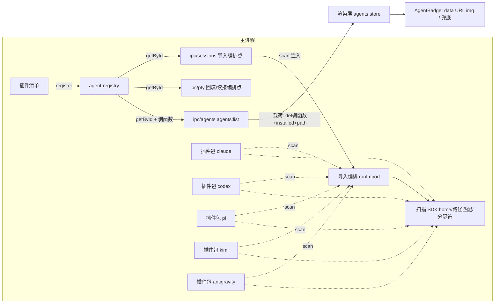

# agent 插件化适配层 · 技术规格

## 整体实现

主进程:每个 agent CLI 一个自包含插件包(声明数据、状态规则、扫描器、fixture 回放测试、随包 helper 同住),由插件清单统一装载进通用注册表(注册表本身零改动)。依赖反转:导入编排不再向注册表查询扫描器,改为**调用方注入**——agents:list 与导入/回填的编排点全部在 IPC 层,IPC 从注册表取插件、把扫描器递给编排,从此导入框架对 agents 域零依赖(单向:插件包 → 扫描 SDK)。渲染层:启动时经 agents:list 装载一份 agent 载荷(含品牌色与 SVG 图标字符串)进 store,徽标、弹窗全部按载荷渲染;SVG 字符串经 data URL 交给 ``,未知 agent 渲染兜底图标。现有五个 agent 是首批五个插件包,行为零变化。

## 流程图



插件包 → 扫描 SDK 为单向依赖;导入框架、注册表互相零依赖,组合全部发生在 IPC 层(AGENTS.md:其余组合点一律留在 IPC 层)。

## 数据结构

```ts
// shared/types.ts:AgentId 从封闭联合开放为字符串(现有五 id 成为插件各自的 id 字面量)
type AgentId = string

// shared/agents.ts:AgentDefinition 扩展
interface AgentDefinition {
  id: string // 开放后的稳定 id
  name: string
  command: string
  aliases?: string[]
  icon?: string // 可选:完整 SVG 文档字符串(插件包 icon.svg 由装载器读入,或定义内联)
  color: string // 品牌色(固定色值,不随主题;icon 缺失时的兜底砖用色)
  state: AgentStateRules // 形态不变
  sessions?: {
    scan?: (projectPath: string, ctx?: { homeDir?: string }) => Promise<ImportCandidate[]>
    resumeArgv?: (ref: ResumeRef) => string[] | null
  }
}

// agents:list 载荷形态不变(def 携带 icon/color 字符串,函数出站剥离)
interface AgentListItem {
  def: AgentDefinition
  installed: boolean
  path?: string
}

// 渲染层新增 agents 载荷 store(UiState 之外的独立切片)
interface AgentsSlice {
  agents: AgentListItem[] // 启动装载一次
  loadAgents: () => Promise<void>
}
```

导入编排新签名(依赖反转):`runImport` 的入参从「agentId 查注册表」改为携带 `scan` 注入与 `agentId`;无扫描器时仍返回 `{ imported: 0 }`。

## 模块划分

- `src/shared/types.ts` -- AgentId 开放为字符串;其余不动
- `src/shared/agents.ts` -- 契约扩展(icon 语义、color 字段);剥离函数的出站注释沿用
- `src/main/agents/agent-registry.ts` -- 通用注册表,行为不变;不再 import 任何具体插件
- `src/main/agents/plugins/index.ts` -- 新增;插件清单:import 五个插件包并逐个 register
- `src/main/agents/plugins/<id>/` -- 新增 ×5;每包:`plugin.ts`(定义:meta + 状态规则 + 品牌色 + sessions 挂接;icon 经 SDK helper 读同目录 icon.svg,可内联覆盖)、`icon.svg`(品牌图标,可选)、`scan.ts`(扫描器,自 session-import 迁入)、随包 helper(claude-project-dir-encoding / codex-rollout-files)、`__fixtures__/` 与 `<id>.test.ts`(fixture 回放,随迁)
- `src/main/session-store/session-import/` -- 收敛为导入框架:`index.ts`(编排,scan 注入)、SDK 三件(agent-home / path-match / runtime-path-separators)、框架测试(run-import / path-match / agent-home)、守卫测试(scan-wiring,新增反向依赖断言);**五个扫描器与 per-agent helper 迁出**;`__fixtures__` 中五个 agent 的转录 fixture 随迁
- `src/main/agent-state/` -- 零改动(引擎消费注册表规则;采样 fixture 是引擎分支样本,留守)
- `src/main/ipc/sessions.ts`、`src/main/ipc/pty.ts` -- 组合点:从注册表取插件、把 scan 递给编排/回填
- `src/main/ipc/agents.ts` -- 剥函数逻辑不变(def 上 icon/color 为字符串,天然可克隆)
- `src/renderer/src/store/agents-slice.ts` -- 新增;agents 载荷装载与按 id 查找(未知返回兜底描述)
- `src/renderer/src/agents-display.tsx` -- 泛化:按载荷渲染(有 icon 走 data URL img;无 icon 渲染「品牌色 + 首字母」兜底砖;完全未知 agent 用中性色同款;不再持任何按 id 硬编码表
- 删除:`src/renderer/src/agents-icons.tsx`(品牌 SVG 以字符串形态迁入各插件包)

依赖方向:插件包 → 注册表接口 + 扫描 SDK(单向);IPC 层 → 注册表 + 导入框架(组合点);渲染层 → store。无任何反向。

## 技术选型与约束

- 有图标的 agent:SVG 文档经 data URL 交给 ``(五枚均为固定自配色,不含 currentColor 依赖);无图标:品牌色 + 首字母兜底砖;装载器读 icon.svg 在打包后可用(asar 对 readFileSync 透明)
- 未知 agent 兜底图标用现有 lucide 图标集(不新增依赖),中性配色
- 五个品牌 SVG 字符串内容 = 现渲染组件的定稿图形(2026-11-22 预览定稿),迁入插件包为字符串常量,图形本身零改动
- 状态引擎、PTY、会话存储、backfill 资格、通知:零改动

## 覆盖标准

档位:抽样档

理由:主体是机械迁移,回归网 = 既有 fixture 回放 + 195 条测试全量(迁移前后全绿是硬门槛);新逻辑只有「清单装载」「scan 注入」「反向依赖」「渲染兜底」四处,无维度组合爆炸。

最可能咬到的五种情况:

1. 反向依赖回潮:session-import 生产代码 import agents 域 → 静态守卫断言失败 → 钉在 T1 守卫用例
2. 插件登记遗漏扫描器:定义缺 sessions.scan,导入静默 0 条 → 钉在 T1 scan-wiring 既有守卫(改写延续,不 mock 注册表)
3. runImport 注入语义:传入扫描器即用;未登记 agent(无扫描器)返回 0 条不抛错 → 钉在 T1 编排用例(改造既有打桩形态)
4. 渲染层未知 agent:store 查无此 id → 返回兜底描述不抛错 → 钉在 T2 agents-slice 单测
5. 载荷形状:icon 缺省 undefined、有值时为 SVG 文档字符串;color 为色值;sessions 函数已剥离 → 钉在 T1 载荷断言(对剥离结果)

隐含高风险输入扫描:别名归一(注册表既有行为,既有用例覆盖);settings 默认 agent 持久化为任意字符串(类型面已开放,机检);state 采样 fixture(agent-state 零改动,既有回放覆盖)。合并前机检:全量测试 + typecheck + `electron-builder --dir ` 打包冒烟。

## 接口面清单

- `agent-registry.register / getById / list` -- 非接缝 -- 行为不变的通用注册表
- `plugins/index` 装载 -- 接缝 -- 插件清单登记的唯一写入口(登记/去重语义,守卫用例钉住)
- `runImport`(scan 注入)- 接缝 -- 编排;依赖反转后不再查询注册表
- `session-import` SDK(agent-home / path-match / runtime-path-separators)-- 非接缝 -- 随迁纯函数,既有测试覆盖
- `agents:list` 载荷 -- 接缝 -- def 增可选 icon(SVG 文档字符串)与 color 字段;函数剥离沿用
- `<id>.plugin`(五个)-- 非接缝 -- 插件声明对象;重用语义:模块级常量,无内部状态
- 渲染层 `agents-slice`(agents / loadAgents / agentById)-- 非接缝 -- 渲染层内部状态;手动冒烟覆盖
- 删除:`agents-icons.tsx`(渲染层品牌图标组件)、AgentDefinition 的首字母 icon 语义
