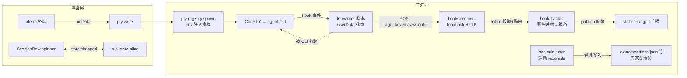

# Hook 驱动的运行状态识别 · 技术规格

## 整体实现

状态证据源整体换血:读屏三源(标题 / 屏幕快照 / 字节环)退役,引擎输入改为「agent hook 事件 + PTY 生命周期」。链路:PTY spawn 时注入环境变量令牌(`SOLOPORT_SESSION_ID` / `SOLOPORT_HOOK_PORT` / `SOLOPORT_HOOK_TOKEN`)→ agent CLI 按项目级 hook 配置(注入器启动时合并写入)拉起共享转发脚本 → 脚本读 env + stdin 事件载荷,POST 到主进程 loopback 接收器 → 接收器按令牌路由到会话 tracker → 插件声明的事件映射判定状态 → 事实直落 `publish()`(不经去抖,同 `exited` 模式)→ `state:changed` 广播。`SessionRunState` 四态枚举、渲染层 spinner、T11 等输入通知零改动。kimi 全局注入(marker 块)为用户明示授权的例外,新 ADR(0007)取代 ADR-0001 时载明。

## 流程图



## 数据结构

```ts
// shared/agents.ts:AgentStateRules 重构(破坏性,五插件同步改写)
interface AgentStateRules {
  hooks: {
    working: string[] // 事件名 → 置 working
    waiting: string[] // 事件名 → 置 waiting
    idle: string[]    // 事件名 → 置 idle
  }
}
// 删除:degraded、title、screen、bytes、idleQuietMs(hook 事实直落,无安静门槛)

// 各家映射(事件名 = 各 CLI 原生事件名,脚本按事件分别注册、命令参数携带):
// claude      working: [UserPromptSubmit, PostToolUse]  waiting: [PermissionRequest, Notification①]  idle: [Stop, StopFailure]
// codex       working: [UserPromptSubmit, PostToolUse]  waiting: [PermissionRequest]                 idle: [Stop]
// kimi        working: [TurnStarted, UserPromptSubmit, PermissionResult]  waiting: [PermissionRequest]  idle: [Stop, StopFailure, Interrupt]
// pi          working: [input, turn_start, turn_end, ui_prompt_end]  waiting: [ui_prompt_start, project_trust]  idle: [agent_settled, session_shutdown]
// antigravity working: [PreInvocation, PostToolUse]     waiting: [](无事件,此态不出现)               idle: [Stop]
// ① Notification 覆盖面比 PermissionRequest 广,实施期实机校准,可能收窄

// shared/ipc-contract.ts
// 删:state:title / state:snapshot 上行通道、StateApi.reportTitle / reportSnapshot
// 留:state:changed 下行(载荷不变)
// 增:hooks:remove → 无参 → Promise<void>(移除全部 managed 注入,kimi 全局含内)

// pty spawn 载荷新增注入 env(pty-registry spawn 的 env 段追加,由 ipc/pty 组合传入):
SOLOPORT_SESSION_ID = <SessionId>
SOLOPORT_HOOK_PORT   = <receiver 随机端口>
SOLOPORT_HOOK_TOKEN  = <每次应用启动随机生成,POST 头校验,防本机其他进程伪造>
```

## 模块划分

- `src/shared/agents.ts` -- AgentStateRules 重构如上;五插件 `plugin.ts` state 段同步改写
- `src/main/agent-state/hook-tracker.ts` -- 新引擎接缝 `createHookTracker(def, opts)`:输入 `onHookEvent(event)` / `onExit()`;事实直落 publish(next===state 早退即幂等);创建即 seed idle;保留 onChange/state;`state-parser.ts` 与五家读屏 fixture、`state-parser.test.ts` **删除**,替换为 `hook-tracker.test.ts` + `__fixtures__/*.hook-fixture.ts`(事件序列回放)
- `src/main/agent-hooks/` -- 新领域目录:
  - `receiver.ts` -- loopback HTTP(127.0.0.1,listen(0) 取随机端口);POST /hook;校验 header token + body {agent, sessionId, event};路由 = token 对应会话有活动 PTY(`activeSessionIds` 守卫,沿 trackerForPty 先例)→ 喂 tracker;无主丢弃;body 上限 64KB;路由判定抽纯函数接缝
  - `forwarder-script.ts` -- 纯函数生成转发脚本文本(读 stdin→读 env→fetch POST→恒 exit 0,任何失败静默);事件名与 agentId 走命令行参数(`node forwarder.mjs --agent <id> --event <Event>`),不解析各家 payload 字段差异;脚本落盘 `userData/hook-scripts/forwarder.mjs`(带版本注释,reconcile 时覆盖,路径跨应用更新稳定)
  - `injector.ts` -- 编排:启动 reconcile(脚本落盘 → 遍历已添加项目 × 有声明的插件写配置 → kimi 全局一次);运行期项目添加补写;spawn 前校验(缺则补,自愈);显式移除(hooks:remove)
  - `merge/claude-settings.ts` -- settings.json 合并/认领/摘除:认领 = hooks 条目 command 含本应用脚本路径;用户已有条目(含用户自己的 hooks/permissions)逐字节保留;摘除后空 hooks 键清理
  - `merge/hooks-json.ts` -- codex `.codex/hooks.json` 与 antigravity `.agents/hooks.json` 共用(JSON event→handlers 结构,认领同上)
  - `merge/kimi-toml.ts` -- marker 块注入/摘除(`# >>> soloport-managed-kimi-hooks >>>` 包 `[[hooks]]` 表),从 Orca kimi-hook-config-toml.ts 裁剪移植;认领 = command 指向本应用脚本;未知结构 fail-closed 不动
  - 插件声明扩展(shared/agents.ts):`hooks?: { kind: 'claude-settings'|'codex-json'|'antigravity-json'|'pi-extension'|'kimi-toml', events: { working|waiting|idle 对应的事件注册清单 } }`——注入器按声明消费,框架零改动(ADR-0006 边界)
- `src/main/agents/plugins/pi/extension-template.ts` -- pi 扩展模板(写入项目 `.pi/extensions/soloport-state.ts`):进程内订阅 input/turn_start/turn_end/ui_prompt_start/ui_prompt_end/project_trust/agent_settled/session_shutdown,读 `process.env` 令牌,直接 fetch POST(不经脚本)
- `src/main/ipc/state.ts` -- 重写:删 title/snapshot/bytes 三路喂食;挂 receiver → tracker 表(生命周期 = PTY 生命周期,`{seed}` 沿用);maybeNotify(等输入通知)接线保留,seed 不发语义保留
- `src/main/ipc/pty.ts` -- spawn 组合点传入三个 env 值 + spawn 前调 `injector.ensureProject(projectPath)`
- `src/main/ipc/channels.ts` + `src/shared/ipc-contract.ts` + preload -- 契约增删如上
- `src/renderer/.../use-terminal.ts` -- 删 scheduleSnapshot / serializeVisibleLines / snapshotTimers / lastSnapshotText / onTitleChange 上行订阅(标题不再作证据);onData→write、滚轮、resize 全不动;相关测试用例删
- 零改动:run-state-slice、SessionRow spinner、notify.ts、sessions-slice、状态通知 UI

## 技术选型与约束

- **hook 命令形态(2026-11-23 claude 2.1.220 实机探针定案)**:命令串 = `<userData>/hook-scripts/soloport-hook.cmd --agent <id> --event <Event>`——裸路径 + 正斜杠 + 无引号 + 无空格,是实测唯一触发形态(Orca exe 同款);cbm 式 `cmd.exe /d /v:off /s /c '"\"…""'` 双引号包装在本版本不触发。launcher(.cmd)内部引号原生安全,承载带空格的 node 绝对路径(`resolveCommandPath('node')` 解析,缺失回退裸名如实暴露)。stdin 载荷实测正常写入并关闭(claude),转发脚本保留 stdin 转交
- **env 继承已实机验证 ✅**(探针链:env 注入 → claude → hook 脚本,token/sessionId 分毫不差;payload 337 字节含 hook_event_name/session_id/cwd)。kimi/codex/antigravity 未装,装后复核
- **claude 信任门槛(实测)**:未信任目录下 `-p` 模式不触发 hooks;交互模式(本应用 PTY 用法)首会话由 claude 自行弹信任对话框,接受后 hooks 生效(当前会话是否立即生效待冒烟确认)——首项目首会话可能无状态,属 claude 侧行为,文档说明不算缺陷
- codex `.codex/hooks.json` 与 pi `.pi/extensions/` 同受各自 CLI 信任门槛:未信任 = 静默无信号 = 恒 idle(明码标价,不算缺陷);应用不代答信任
- 接收器只绑定 127.0.0.1;token 一次性随机值防伪造;POST 无 body/坏 body 静默 400,不影响 CLI
- 应用外裸跑 agent:无 env 令牌 → 脚本早退零发送(kimi 全局配置同样受益),「影响应用外会话」从根上不存在
- working 卡死(hook 失联)v1 不自动降级,PTY 退出兜底(用户已确认)

## 覆盖标准

档位:接缝全测档

理由:引擎语义换血 + 用户配置合并是本特性两个高风险面,前者用事件序列 fixture 回放(每家正/反样本:提交→working、Stop→idle、权限→waiting→批准事件→working、同态幂等、无主事件丢弃),后者用合并/认领/摘除纯函数全分支用例(用户预置内容逐字节保留为硬断言);receiver 编排(import http)与注入编排(import fs/注册表)按 T5/T8 先例靠冒烟,路由判定抽纯函数补接缝。

最可能咬到的六种情况:

1. 事件映射错位(某事件挂错槽)→ 钉在各家 fixture 回放正/反样本
2. 合并破坏用户配置(覆盖用户 hooks/permissions、TOML 撕裂)→ 钉在 merge 接缝「用户内容逐字节保留」硬断言
3. 路由串台(令牌校验绕过、无主事件误喂)→ 钉在路由纯接缝用例(token 不匹配/会话无 PTY/未知 agent 三反例)
4. 同态幂等失效(重复事件反复广播)→ 钉在 hook-tracker publish 早退用例
5. forwarder 脚本 env 缺失不早退(应用外会话收到 POST)→ 钉在脚本生成文本断言 + 实机探针
6. 契约删除残留(渲染层仍上行 title/snapshot)→ typecheck 抓(桥方法已删)+ T4 清理清单逐项 grep

## 接口面清单

- `createHookTracker` -- 接缝 -- 引擎唯一入口;onHookEvent/onExit/state/onChange;seed idle;直落语义
- `receiver.listen()/stop()` + 路由判定纯函数 -- 接缝 -- 端口获取、token 校验、无主丢弃
- `forwarder-script.generate()` -- 接缝 -- 脚本文本纯函数;env 缺失早退逻辑文本级断言
- `merge/{claude-settings,hooks-json,kimi-toml}` -- 接缝 -- apply/claim/remove 三操作 × 用户内容保留硬断言
- `injector.reconcile()/ensureProject()/remove()/removeAll()` -- 接缝外的编排(import fs/注册表,冒烟);spawn 前校验 = ensureProject
- 插件 `hooks` 声明 -- 接缝 -- 注入器消费的唯一来源;无声明的插件跳过(向前兼容)
- `hooks:remove` IPC -- 接缝 -- 显式移除全部注入;UI 入口位置为授权项(移除 seam 本任务落全)
- 删除:`state-parser.ts`、`state:title`/`state:snapshot` 通道与 preload 对应方法、use-terminal 快照节流块、五家读屏 fixture、AgentStateRules 旧字段(degraded/title/screen/bytes/idleQuietMs)
