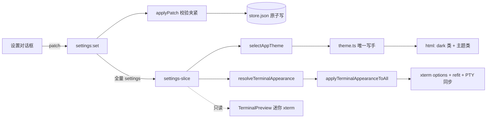

# 主题与样式设置 · 技术规格

## 整体实现

**主干**:设置存「选了哪套」的 id,渲染层按三态解析出实际主题,一套写手把界面 token 与终端配色落到 html 类和 xterm 选项。

**数据怎么进**

- 用户在设置对话框改任何项 → `settings:set` patch → 主进程校验后原子写 store.json 并返回全量 settings。
- 应用启动 → 主进程 loadStore 补缺省字段 → 渲染层 settings slice 初载。
- 系统深浅变化 → 渲染层 matchMedia 与主进程 nativeTheme 各自感知,system 态跟随。

**中间怎么处理**

1. 渲染层 settings slice 持有全量设置,变更后通知订阅者。
2. 界面侧:主题选择解析(三态 + 系统深浅 + 双槽)→ theme.ts 写 html 类(dark + 主题类)→ CSS 变量整体换色。
3. 终端侧:终端外观解析(设置 → xterm 选项与配色)→ 已开终端 applyOptions;度量类变更后全量 refit 并走既有 resize 链路同步 PTY。
4. 预览块:独立迷你 xterm,只读消费同一套解析函数,不接 PTY。

**从哪出 / 什么时候算结束**

- 界面出 html 类,CSS 变量命中 Tailwind 语义类;终端出 xterm options,即时生效。
- 任一解析遇到目录外 id 或越界值,按默认值兜底,不报错不中断。
- 设置即改即存,「完成」只关对话框;失败落盘时控制台报错,下次启动读回旧值。

## 流程图



## 数据结构

> 第二版(2026-11-24,J-005):主题为单槽单色板;三态与深浅双槽删除。

`src/shared/types.ts` 的 Settings(既有字段保留,主题相关字段改为单槽):

```ts
interface Settings {
  // ……既有:defaultAgentId?、scrollbackRows、shell
  appTheme: string // 界面主题 id,默认 'github-dark'
  terminalTheme: string // 终端配色名(Orca 原名),默认 'Ghostty Default Style Dark'
  terminalFontFamily?: string // 缺省 = 默认回退链
  terminalFontSize: number // 默认 14,范围 [8, 32]
  terminalFontWeight: number // 默认 300,档位 300/400/500
  terminalLineHeight: number // 默认 1.0,范围 [1.0, 2.0]
  terminalCursorStyle: 'block' | 'bar' | 'underline' // 默认 'block'
  terminalCursorBlink: boolean // 默认 false
}
// 删除:theme(三态)、appThemeDark、appThemeLight、terminalThemeDark、terminalThemeLight
```

界面主题数据(`src/shared/themes/app-themes.ts`)——**每套一组 token,带 isDark**:

```ts
type AppThemeId =
  | 'github-dark' | 'github-dark-hc' | 'vscode-dark-modern' | 'carbonfox' | 'tango-dark'
  | 'vscode-light' | 'github-light' | 'gruvbox-light-hard' | 'selenized-white' | 'tango-light'
  | 'flexoki-light' | 'tomorrow'

type AppTokenValues = {
  base: string // 内容区底
  panel: string // 侧栏与面板容器底
  surface: string // 浮层(对话框/菜单/预览)
  line: string // 边框
  ink: string // 主文本
  inkMuted: string // 次文本
  accent: string // 强调底(主按钮)
  onAccent: string // 强调底上的文本
  hover: string // 中性悬停叠加
  accentHover: string // 强调底悬停色
}

type AppTheme = { id: AppThemeId; name: string; isDark: boolean; tokens: AppTokenValues }
// APP_THEMES: AppTheme[],恰 12 套;默认 'github-dark'
```

12 套的 token 值来自 `theme-selection-tokens.json`(由 `theme-selection-gen.py` 生成,
三处用户指定的主色覆盖已固化:github-dark / github-dark-hc 用 `#0078d4`,github-light 与
gruvbox-light-hard 用 `#000000`)。

终端主题数据不变:`TERMINAL_THEMES`(22 套)+ `DARK/LIGHT_TERMINAL_THEME_NAMES`(下拉分组用)。

token 落地(`theme-tokens.css`):`:root` 保留一套兜底变量;每套主题一个 `.theme-<id>` 块覆盖
`--app-*` 十个变量;不再有 `.dark.theme-<id>` 的成对结构。`color-scheme` 由 `applyAppearance`
按 `isDark` 写到 `<html>`,同时按需切换 `.dark` 类(Tailwind 的 dark: 变体兜底)。

**旧数据迁移**(loadStore):若 `appTheme` 缺失,按顺序尝试 `appThemeDark` → `appThemeLight`
→ 默认 `github-dark`;旧 id('default'/'warm'/'cool'/…)不在新目录内,因此统一落默认。
`terminalTheme` 缺失时取 `terminalThemeDark` → `terminalThemeLight` → 默认 Ghostty 深色。

## 模块划分

| 模块路径 | 职责 | 依赖 |
|---|---|---|
| `src/shared/types.ts` | Settings 形状扩展 | — |
| `src/shared/themes/catalog.ts` | 22 套终端主题数据(移植 Orca) | types |
| `src/shared/themes/app-themes.ts` | 8 套界面主题数据 | types |
| `src/shared/themes/fonts.ts` | 字体预置清单与默认回退链 | — |
| `src/shared/themes/resolve.ts` | selectAppTheme / selectTerminalTheme / resolveTerminalAppearance 纯函数 | catalog、app-themes、fonts、types |
| `src/renderer/src/assets/theme-tokens.css` + `main.css` | token 变量与语义 utility 映射 | — |
| `src/renderer/src/theme.ts` | html 类唯一写手(dark + 主题类) | resolve |
| `src/renderer/src/store/settings-slice.ts` | 渲染层设置状态:初载、patch、订阅 | types、ipc/bridge |
| `src/renderer/src/components/settings/` | SettingsDialog + Appearance/General 分区 + TerminalPreview | slice、resolve、themes |
| `src/renderer/src/components/sidebar/MoreMenu.tsx` | 增加「设置」入口(既有文件) | settings/ |
| `src/renderer/src/components/terminal/use-terminal.ts` | options 改走解析;新增全终端外观应用 | resolve、slice |
| `src/renderer/src/components/terminal/TerminalView.tsx` | 订阅设置变化触发应用(既有文件) | use-terminal、slice |
| `src/main/ipc/settings.ts` | applyPatch 校验扩展(既有文件) | types |
| `src/main/session-store/store-persistence.ts` | DEFAULT_STORE.settings 扩展,读入补缺(既有文件) | types |

## 技术选型与约束

- 零新增依赖:xterm/lucide-react/Tailwind 4 已在用;预览块复用 `@xterm/xterm`。
- Tailwind 4 class 策略深色变体不动;`@custom-variant dark` 保持原样。
- 「谁写 html 类」保持一处(theme.ts);对话框与终端只发 patch/订阅,不碰 DOM 根。
- 终端度量变更必须走 applyOptions + fit,并依赖既有 onResize → pty.resize 链路;scrollback 沿用变化即重建实例。
- 主题数据文件头标注移植来源(`// Ported from stablyai/orca ...`,MIT)。
- vitest 单测与源码同目录;主进程与渲染层测试均在 `pnpm test` 内。

## 覆盖标准

**接缝一:主题选择解析(selectAppTheme / selectTerminalTheme)——完整档**

理由:三态 × 系统深浅 × 双槽是真组合,状态机风险。

| 三态 | 系统深浅 | 期望要点 | 主测接缝 | 落在哪 |
|---|---|---|---|---|
| dark | 任意 | 两域都取深槽 | 函数级 selectX | T3 用例 1、T4 用例 1 |
| light | 任意 | 两域都取浅槽 | 函数级 selectX | T3 用例 2、T4 用例 2 |
| system | 深 | 取深槽 | 函数级 selectX | T3 用例 3、T4 用例 3 |
| system | 浅 | 取浅槽 | 函数级 selectX | T3 用例 4、T4 用例 4 |
| 任意 | 任意 | 槽 id 不在目录 → 该域落默认主题 | 函数级 selectX | T3 用例 5、T4 用例 5 |
| 任意 | 任意 | 界面与终端互不跟随,各自解析 | 函数级 selectX | T4 用例 6 |

**接缝二:终端外观解析(resolveTerminalAppearance)——抽样档**

理由:各字段独立映射,无维度组合;错误代价是显示偏差,不是数据损坏。

最可能咬到的五种:

1. 字体缺省 → 输出完整默认回退链 → 函数级 → T3 用例 6
2. 字体选具体项 → 该字体插链首,原链其余保留 → 函数级 → T3 用例 7
3. fontSize 3 / 99 → 夹紧 8 / 32 → 函数级 → T3 用例 8
4. lineHeight 0.5 / 3 → 夹紧 1.0 / 2.0 → 函数级 → T3 用例 9
5. cursorStyle 三枚举映射正确,坏值兜底 block → 函数级 → T3 用例 10

**接缝三:设置持久化兼容(storePersistence)——完整档**

理由:落盘数据,坏兼容直接丢用户设置。

| 场景 | 期望要点 | 主测接缝 | 落在哪 |
|---|---|---|---|
| 旧文件(无任何新字段) | 新字段全部补默认值 | loadStore fixture | T2 用例 1 |
| 新文件全字段 | 原值保留不清洗 | loadStore fixture | T2 用例 2 |
| 部分新字段缺失 | 缺的补默认,有的保留 | loadStore fixture | T2 用例 3 |
| settings 缺失 / 非对象 | 既有损坏兜底路径不回归 | loadStore fixture | T2 用例 4 |
| IPC patch 越界值 | applyPatch 夹紧或忽略,不写坏值 | applyPatch | T2 用例 5、6 |

**接缝四:主题数据完整性——枚举全查(非新接缝,归主题数据两个模块自身的完整性断言)**

| 检查 | 期望要点 | 主测接缝 | 落在哪 |
|---|---|---|---|
| 终端目录 | 恰 22 套、键唯一、ITheme 必需键齐、色值 #rrggbb | catalog 模块级 | T3 用例 11 |
| 界面目录 | 恰 8 套 × 深浅两形态、9 token 齐、色值格式 | app-themes 模块级 | T4 用例 7 |

**接缝五:终端接线(applyTerminalAppearanceToAll)——抽样档(非新接缝,既有 use-terminal.test.ts 扩展)**

只验证接线,不重测解析规则:

1. 设置变更后所有已开终端实例 applyOptions 被调、度量变更触发 fit → Terminal 注册表级 → T5 用例 1
2. options 来源为解析函数输出(字体链、字号、主题色) → use-terminal 模块级 → T5 用例 2
3. system 态运行中系统深浅翻转 → 换槽主题重新应用 → Terminal 注册表级 → T5 用例 3

## 接口面清单

- `getAppTheme` -- 接缝 -- 设置 → 界面主题(坏 id 落默认 github-dark,不再有槽与系统深浅维度)
- `getTerminalTheme` -- 接缝 -- 设置 → 终端配色(坏名落默认 Ghostty 深色)
- `resolveTerminalAppearance` -- 接缝 -- 设置 → xterm 全量外观(签名去掉 systemDark 维度)
- `applyAppearance` -- 接缝 -- theme.ts 唯一写手:写主题类、按 isDark 写 .dark 与 color-scheme
- `useSettings` / `updateSettings` -- 接缝 -- 渲染层设置状态读取与变更
- `applyTerminalAppearanceToAll` -- 接缝 -- 全部已开终端应用解析结果,度量变更触发 refit
- `APP_THEMES` -- 非接缝 -- 8 套界面主题数据,只读
- `TERMINAL_THEMES` -- 非接缝 -- 22 套终端主题数据,只读
- `TERMINAL_FONT_OPTIONS` / `DEFAULT_FONT_FALLBACK_CHAIN` -- 非接缝 -- 字体清单与默认链,只读
- `SettingsDialog` / `AppearanceSection` / `GeneralSection` / `TerminalPreview` -- 非接缝 -- 组件,手动冒烟验证
- `applyPatch`(settings IPC) -- 非接缝 -- 主进程内部校验,模块内导出供单测
- `DEFAULT_STORE.settings` -- 非接缝 -- 新字段默认值唯一来源,loadStore 补缺依据
- `PREVIEW_BUFFER` / `ui-slice` 设置对话框开合 -- 非接缝 -- 预览示例缓冲;对话框开合状态
- `TerminalAppearance` -- 非接缝 -- resolveTerminalAppearance 输出形状,字段见 T3 契约

## 第二版覆盖标准调整

- 接缝一(主题选择解析)从「三态 × 系统深浅 × 双槽」的 6 行矩阵降为 3 行:坏 id 落默认、
  取到目录内主题、`isDark` 与 token 组一致。
- 接缝二(终端外观解析)去掉 `systemDark` 入参,原 5 条用例保留(改签名后仍成立)。
- 接缝三(持久化兼容)新增迁移行:旧文件带 `appThemeDark` 时导出 `appTheme='github-dark'`;
  旧 `terminalThemeDark` 迁移到 `terminalTheme` 仅当名字仍在 22 套目录内。
- 接缝四(主题数据完整性)从 8 套 × 2 形态改为 12 套 × 1 形态 × 10 token。
- 新增接缝六(主题与 CSS 一致):`app-themes-css.test.ts` 改为 12 个 `.theme-<id>` 块逐一比对。
- 删除:三态解析、跟随系统监听、双槽选择相关的一切用例(`resolveDark`、`systemPrefersDark` 删除)。
