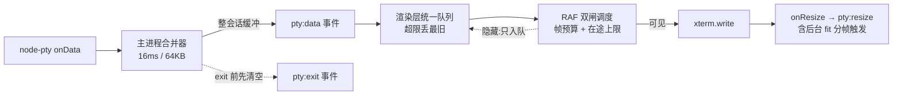

# 终端输出背压与渲染修复 · 技术规格

## 整体实现

**主干**:在既有「主进程单泵转发 + 渲染层常驻 xterm」链路上插入两级流量控制(主进程合并器、渲染层调度器),并以补丁消除 xterm/node-pty 上游缺陷。

**数据怎么进**

- agent 输出字节 → node-pty `onData`(主进程,现状不变)
- 用户键入与滚轮翻页 → 渲染层 `pty:write`(现状不变,本特性不改上行)

**中间怎么处理**

1. 主进程合并器按会话缓冲字节,16ms 窗口或 64KB 阈值先到先发
2. 退出事件发出前,先清空该会话缓冲,保住「尾数据 → 退出」顺序
3. 渲染层把数据入统一队列(注册前后的会话同一条路)
4. 渲染层 RAF 帧循环消费队列:预算闸限制单帧喂入,在途闸以写入回调计数限制未消化量
5. 隐藏终端只入队不消费;激活转可见后按预算渐进追平
6. 窗口尺寸稳定后,隐藏终端按假想网格分帧重设并同步 PTY

**从哪出 / 什么时候算结束**

- 可见终端的队列按帧流干即为消化完成;队列与在途量都有上限,超限丢最旧
- 退出事件仍按 ADR-0004 语义 = shell 死亡,链路上任何一环失败都不改变该语义
- WebGL 上下文丢失 → 该终端降级 DOM 并标记;下次激活尝试重挂,失败保持 DOM

## 流程图



## 数据结构

```ts
// 主进程合并器(src/main/pty-data-coalescer.ts,新文件)
type CoalescerOptions = {
  windowMs: number // 合并窗口,16
  maxChars: number // 单会话缓冲上限,64KB(字符数),到即提前清空
  flush: (sessionId: SessionId, text: string) => void // 清空出口,由接线层投递
}
type PtyDataCoalescer = {
  push(sessionId: SessionId, data: string): void // 入缓冲,窗口起算或续期
  flushSession(sessionId: SessionId): void // 立即清空该会话(exit 保序用)
  destroy(): void // 清全部定时器,测试收尾用
}

// 渲染层调度器(src/renderer/src/components/terminal/terminal-write-scheduler.ts,新文件)
type WriteSchedulerOptions = {
  write: (sessionId: SessionId, chunk: string, done: () => void) => void // 注入的投递口
  frameBudgetChars: number // 单帧单会话喂入上限,256KB
  inflightLimitChars: number // 会话未消化量上限,4MB,到则停喂
  queueLimitChars: number // 会话队列上限,4MB,到则丢队首
}
type WriteScheduler = {
  enqueue(sessionId: SessionId, data: string): void // 入队,注册前后同一条路
  setVisible(sessionId: SessionId, visible: boolean): void
  pump(): void // 每帧一次,由 use-terminal 的 RAF 驱动
  remove(sessionId: SessionId): void // 关标签清理
}

// 既有 TerminalEntry 扩展(use-terminal.ts,内部)
// 新增 webglLost?: boolean —— WebGL 降级标记,T6 重挂依据
// 既有 container / readyFired 字段不变,隐藏判定沿用 container.style.display
```

## 模块划分

- `src/main/pty-data-coalescer.ts`(新):合并器纯逻辑,timer 可注入,不依赖 Electron
- `src/main/ipc/pty.ts`(改):转发接线——`onData` 改入合并器,`onExit` 前先 `flushSession`
- `src/renderer/src/components/terminal/terminal-write-scheduler.ts`(新):队列与双闸纯逻辑,RAF 由 use-terminal 驱动
- `src/renderer/src/components/terminal/use-terminal.ts`(改):数据泵接调度器、pendingData 并入、激活补发与重挂、后台 fit 本体
- `src/renderer/src/components/terminal/stable-resize-gate.ts`(新,T5):窗口 resize 稳定门(抖动合并 + 200ms 计时),纯逻辑
- `config/patches/`(新,T1/T2):两份第三方补丁文件;`package.json` pnpm 段登记
- `src/renderer/src/components/terminal/TerminalTabs.tsx`(改,T7):预览分支不再替换终端渲染,终端组始终挂载、display 隐藏

依赖方向:接线层(ipc/pty.ts、use-terminal)单向依赖两个新纯逻辑模块;两个新模块互不依赖。

## 技术选型与约束

- 补丁机制用 pnpm `patchedDependencies`(package.json pnpm 段),不引 patch-package 等新工具
- 合并器与调度器全部落成可注入 timer/可注入投递口的纯逻辑,timer 用 vitest fake timers 驱动
- 不改上行链路(pty:write),不动 hook 通道、回填、状态机、设置外观链路
- T4 重构后既有 use-terminal 测试必须全绿,数据泵对外行为兼容(先到先存、注册即放语义保持)
- 后台 fit 的假想网格复用既有格子换算逻辑,不另起测量路径;无可见参照时跳过该轮
- WebGL 重挂失败静默保持 DOM,不重试风暴(每次激活至多试一次)

## 覆盖标准

档位按任务分述。T1/T2 为第三方补丁产物,不适用单测矩阵——覆盖 = 重放验证 + 实机冒烟清单(理由:补丁内容为上游已验证修改,本项目无新增逻辑可测)。

### T3 合并器(完整档)

理由:合并器是「缓冲 × 定时 × 阈值 × 保序」的状态机,组合边界是主要风险。

| 维度 / 组合 | 代表输入 | 期望要点 | 主测接缝 | 落在哪 |
|---|---|---|---|---|
| 窗口内多块 | 同会话 3 块连续入,16ms 后 | 合并为 1 条发出 | `pty-data-coalescer` 函数级 | T3 用例 1 |
| 阈值提前 | 单块即超 maxChars | 不等窗口,立即发出 | `pty-data-coalescer` 函数级 | T3 用例 2 |
| 退出保序 | 缓冲未到期时 flushSession | 立即发出且此后不再重复发 | `pty-data-coalescer` 函数级 | T3 用例 3 |
| 多会话隔离 | 两会话交错入 | 各自独立合并,互不串内容 | `pty-data-coalescer` 函数级 | T3 用例 4 |
| 窗口续期 | 块间隔小于窗口、持续入 | 只按最后一块起算,不逐块重置 | `pty-data-coalescer` 函数级 | T3 用例 5 |
| 清理无泄漏 | destroy 后 | 无残留定时器,不再发出 | `pty-data-coalescer` 函数级 | T3 用例 6 |
| 接线保序 | 注册表 exit 路径 | exit 事件前该会话缓冲已投递 | `ipc/pty.ts` 接线 | T3 用例 9(评审 + 冒烟) |

隐含高风险输入显式扫:空字符串入缓冲(不产生空投递)→ T3 用例 7;同 tick 多块超阈 → 归并用例 2 语义覆盖,不另开行。

### T4 调度器(完整档)

理由:双闸是「可见性 × 预算 × 在途」的状态机,丢最旧的正确性直接影响可见画面。

| 维度 / 组合 | 代表输入 | 期望要点 | 主测接缝 | 落在哪 |
|---|---|---|---|---|
| 预算闸 | 单帧入队远超预算 | 本帧喂入 ≤ frameBudget | `terminal-write-scheduler` 函数级 | T4 用例 1 |
| 在途闸 | 喂入后回调未完成且在途超限 | 停喂;回调到达后恢复 | `terminal-write-scheduler` 函数级 | T4 用例 2 |
| 隐藏不消费 | 隐藏会话入队 + pump | 零喂入;转可见后消费 | `terminal-write-scheduler` 函数级 | T4 用例 3 |
| 丢最旧 | 队列超 queueLimit | 丢队首,队尾完整,总量有界 | `terminal-write-scheduler` 函数级 | T4 用例 4 |
| 多会话并行 | A 在途超限,B 正常 | A 停喂不影响 B | `terminal-write-scheduler` 函数级 | T4 用例 5 |
| 先到先存兼容 | 数据早于注册 | 注册后按序消费(既有语义) | `use-terminal` 既有桩 | T4 用例 6(迁移既有用例) |
| 关标签清理 | remove 后 pump | 该会话零喂入,无泄漏 | `terminal-write-scheduler` 函数级 | T4 用例 7 |
| 数据泵接线 | open/close 与调度器的接通 | 数据落对终端、关闭无泄漏(迁移既有桩) | `use-terminal` 既有桩 | T4 用例 8/9 |

隐含高风险输入显式扫:回调双调用/不调用(异常路径)→ 在途计数只按每次投递计一次,T4 用例 2 的实现约束覆盖;队列恰等于上限的边界 → 归并用例 4 语义。

### T5 后台 fit(抽样档)

理由:单向触发(稳定信号 → 重设),无组合维度,错误代价是显示错而非算错。

最可能咬到的五种情况:

1. resize 抖动只触发一次稳定回调 → 主测接缝 `stable-resize-gate` 函数级 → T5 用例 1-3
2. 隐藏才 fit、可见不碰 → 主测接缝 `use-terminal` fit 本体 → T5 用例 4
3. 目标网格 = 假想尺寸换算结果 → 主测接缝 `use-terminal` fit 本体 → T5 用例 5
4. 无可见参照(cell 度量不可得)跳过该轮 → 主测接缝 `use-terminal` fit 本体 → T5 用例 6
5. 分帧:单帧至多处理一个终端 → 主测接缝 `use-terminal` fit 本体 → T5 用例 7

### T6 WebGL 重挂(抽样档)

理由:两状态(丢失/未丢)两出口(重挂成功/失败),无组合维度。

1. 丢失触发标记 → 主测接缝 `use-terminal` 桩 → T6 用例 1
2. 激活重挂成功清标记,不重复挂 → 主测接缝 `use-terminal` 桩 → T6 用例 2
3. 重挂抛错保持 DOM 且不崩 → 主测接缝 `use-terminal` 桩 → T6 用例 3
4. 未丢失终端激活不触发挂载 → 主测接缝 `use-terminal` 桩 → T6 用例 4

### T7 预览共存渲染(实机复现 + 全量)

无单测接缝(组件渲染结构,项目无渲染测试基建,debugging 收尾清单登记「无正确 seam」)。覆盖 = 原始报障场景复现验证:pi 会话运行中激活预览 → 切回,画面完整无双 TUI、TUI 滚动正常、内容无截断;叠加全量套件绿(TerminalView 本体零改动,use-terminal 既有桩全绿即结构未破坏)。

### T1/T2 补丁(重放验证 + 冒烟)

- T1:重放零冲突、`node_modules` 内源码段含补丁标记、类型检查与全部既有单测绿(条数与基线一致)、冒烟清单逐项过
- T2:重放零冲突、三场景退出冒烟、多终端互不影响
- waiver 预登记:第三方产物无新增逻辑,单测不适用

## 接口面清单

- `pty-data-coalescer.createPtyDataCoalescer` -- 接缝 -- 每会话缓冲合并与定时清空
- `pty-data-coalescer.CoalescerOptions` -- 非接缝 -- 选项类型
- `terminal-write-scheduler.createWriteScheduler` -- 接缝 -- 队列与双闸调度
- `terminal-write-scheduler.WriteSchedulerOptions` -- 非接缝 -- 选项类型
- `stable-resize-gate.createStableResizeGate` -- 接缝 -- 窗口抖动合并与稳定回调
- `use-terminal.openTerminal` -- 非接缝(既有,行为扩展) -- 创建实例并接入调度器,签名不变
- `use-terminal.activateTerminal` -- 非接缝(既有,行为扩展) -- 转可见、补发 ready、WebGL 重挂,签名不变
- `use-terminal.closeTerminal` -- 非接缝(既有,行为扩展) -- 移除会话与队列,签名不变
- `use-terminal.applyTerminalAppearanceToAll` -- 非接缝(既有,不变) -- 本特性不触碰其语义
- `use-terminal.fitHiddenTerminals` -- 接缝 -- 对全部隐藏终端按假想尺寸分帧重设
- `ipc/pty.ts` 转发接线 -- 非接缝 -- 消费合并器,不单独导出
- `TerminalTabs.tsx` 预览共存渲染 -- 非接缝 -- 渲染结构修改(T7),无新增导出
