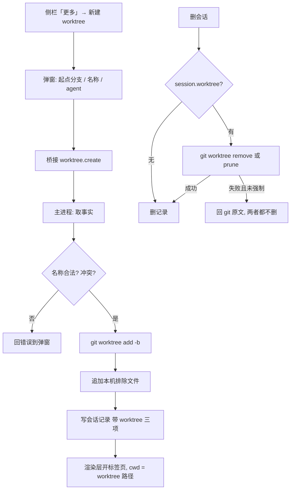

# Git worktree 会话 · 技术规格

## 整体实现

**主干**:渲染层弹窗收集三件事,主进程建 git worktree 并落会话记录,渲染层随即开标签页。

**数据怎么进**

- 用户在项目行「更多」菜单点「新建 worktree」,带出该项目 id。
- 弹窗内取三样:起点分支(经既有 `git.branches` 拿本地分支)、名称、agent id。
- 主进程再自取三样事实:目标目录是否存在、git 已登记的 worktree 路径、已有会话占用的路径。

**中间怎么处理**

1. 名称校验:不合法直接回错误,不执行任何 git 命令。
2. 冲突判定:目录已存在、路径已被 git 登记、已有会话占用该路径,三者任一命中即拒。
3. 执行 `git worktree add -b <名称> <目标路径> <起点分支>`。
4. 追加 `.worktree/` 到仓库本机排除文件,幂等;写失败只告警。
5. 会话记录写入 worktree 三项,连同项目 id 与 agent id。
6. 渲染层拿到会话,按会话运行目录开标签页并 spawn。

**从哪出 / 什么时候算结束**

- 成功出口:一条带 worktree 的会话,终端在该目录里跑 agent。
- 失败出口:错误原样回到弹窗,不落记录、不留半成品。worktree 已建而记录失败时,不删目录,提示手工处理。
- 删除出口:删会话时先删目录再删记录;目录删不掉则两者都不动。

## 流程图



## 数据结构

```ts
// shared/types.ts
export interface SessionWorktree {
  path: string // worktree 目录绝对路径,归一化存储
  branch: string // 建出来时使用的分支名,同时是目录名
  baseBranch: string // 起点分支名
}

export interface Session {
  // …既有字段不变
  worktree?: SessionWorktree // 缺省 = 普通会话,运行目录取所属项目路径
}
```

```ts
// shared/ipc-contract.ts
export type WorktreeFailure =
  | 'name-invalid' // 名称不合法
  | 'dir-exists' // 目标目录已存在
  | 'path-registered' // 该路径已被 git 登记为 worktree
  | 'session-taken' // 已有会话占用该路径
  | 'git-error' // git 命令失败,原文在 detail

export type WorktreeCreateResult =
  | { ok: true; session: Session }
  | { ok: false; failure: WorktreeFailure; detail?: string }

export interface WorktreeApi {
  isRepoRoot: (path: string) => Promise<boolean>
  create: (p: {
    projectId: ProjectId
    name: string
    baseBranch: string
    agentId: AgentId
  }) => Promise<WorktreeCreateResult>
}

export interface SessionsApi {
  // 既有签名;新增可选参数,不传时行为与今天一致
  remove: (
    id: SessionId,
    options?: { forceWorktree?: boolean }
  ) => Promise<{ closedTabs: SessionId[]; worktreeError?: string }>
}
```

`worktreeError` 存在即表示 worktree 没删成、会话记录也没删。渲染层据此弹二次确认。

## 模块划分

- `src/shared/types.ts` — 会话的 worktree 三项(数据形状)。
- `src/shared/session-dir.ts` — 会话运行目录的唯一来源。**依赖**:`shared/types`;被渲染层与主进程共用。
- `src/shared/ipc-contract.ts`、`src/main/ipc/channels.ts` — 新通道名与载荷类型,一一对应。
- `src/main/git-worktree.ts` — worktree 能力层:七个纯函数 + 一个可注入执行器的服务。**依赖**:`node:fs`、git 命令一律经注入的执行器,生产实现走 `GitRepo.raw`。
- `src/main/ipc/worktree.ts` — 两个通道的编排:取事实 → 判定 → 执行 → 建记录。
- `src/main/ipc/sessions.ts` — 删除编排扩展:先删目录再删记录。
- `src/main/session-store/session-records.ts` — 既有记录接缝,增加写入与读取 worktree。
- `src/main/index.ts`、`src/preload/index.ts` — 注册与桥接。
- `src/renderer/src/panel-root.ts` — 面板显示哪个目录(纯函数)。
- `src/renderer/src/App.tsx` — 算出目录并下传给两个面板,「VS Code 打开」同源。
- `src/renderer/src/components/file-panel/FileTreePanel.tsx`、`components/git-panel/GitPanel.tsx` — 改为收 `root` prop,不再自查选中项目。
- `src/renderer/src/components/sidebar/MoreMenu.tsx` — 菜单项,按仓库根判定显示。
- `src/renderer/src/components/sidebar/WorktreeDialog.tsx` — 弹窗本体。
- `src/renderer/src/store/ui-slice.ts` — 弹窗开合与目标项目。
- `src/renderer/src/store/sessions-slice.ts` — 建与删的编排。
- `src/renderer/src/components/sidebar/SessionRow.tsx`、`Sidebar.tsx` — 分支小字与强制删除二次确认。

## 技术选型与约束

- worktree 命令一律拼成参数数组交执行器,不新增依赖:`git-service.ts` 的 `GitRepo` 加一个 `raw(args)`,worktree 与既有七通道共用同一个 simple-git 实例与 root 缓存。
- 执行器注入:服务接受 `(root: string, args: string[]) => Promise<string>`,root 由每个动作自带;单测传假实现,不打真实 git。
- 测试环境是 node,不做组件测试。渲染层的验证落在 store 与纯函数,界面由冒烟验。
- 名称校验按 `git check-ref-format` 的常用子集实现:非空、只含 `A-Za-z0-9._/-`、不含 `..`、不以 `/`、`.`、`-` 开头或结尾。
- 排除文件固定在 `<项目>/.git/info/exclude`;入口只在「仓库根 == 项目目录」时提供,故不必回溯上级目录。
- 渲染层不得直接读写文件系统,一切经桥接。
- 删除先删目录后删记录;删目录失败时记录必须原样保留,避免出现「记录没了但目录还在」的孤儿。

## 覆盖标准

档位:抽样档

理由:各接缝均为单向转换(名称→是否合法、原文→追加后原文、porcelain→列表、三类事实→冲突结论)。唯一的状态组合是两处 2×2,逐行枚举即可。错判代价高,故失败面全部进表。

最可能咬到用户的五种情况:

1. 名称含空格或 `~`、或以 `/` 结尾 → 报名称非法,一条 git 命令都不执行 → 主测接缝 `validateWorktreeName` 函数级 → T2 用例 1、2、3
2. 目录已被手工删掉但 git 仍登记该路径 → 判 `path-registered`,提示先清理 → 主测接缝 `decideCreateConflict` 函数级 → T2 用例 12
3. 排除文件里已有 `.worktree/` → 不重复追加 → 主测接缝 `buildExcludeContent` 函数级 → T2 用例 5
4. 有未提交改动时删会话 → 目录与记录都不动,回传 git 原文 → 主测接缝 删除编排(经桥接) → T3 用例 3
5. 目录已消失但 git 仍登记 → 选 prune 而非 remove,幂等成功 → 主测接缝 `pickRemovalAction` 函数级 → T3 用例 2

其余高风险输入(必须落地):

6. 旧记录没有 worktree 字段 → 运行目录回落项目路径 → `resolveSessionDir` → T1 用例 1
7. 活动会话所属项目已被移除 → 面板回落选中项目,不抛错 → `resolvePanelRoot` → T1 用例 8
8. porcelain 出现 bare 或 detached 条目 → 解析不崩,branch 为空串 → `parseWorktreeList` → T2 用例 9
9. 已有会话指向同一路径 → 判 `session-taken` → `decideCreateConflict` → T2 用例 13
10. 带强制参数删除 → 用 `--force` 执行 → 删除编排 → T3 用例 4
11. 名称合法但 git 报错(分支已存在等) → 原文回传,记录不落 → 编排层 → T2 用例 16
12. 目录与 git 登记都不在 → 跳过删除,记录照删 → `pickRemovalAction` → T3 用例 5
13. 无活动标签但右栏开着 → 面板回落选中项目 → `resolvePanelRoot` → T1 用例 6
14. 活动会话带 worktree → 面板用 worktree 路径 → `resolveSessionDir` + `resolvePanelRoot` → T1 用例 2、4

## 接口面清单

- `session-dir.resolveSessionDir` -- 接缝 -- 由会话与项目算出运行目录
- `panel-root.resolvePanelRoot` -- 接缝 -- 由活动会话与选中项目算出面板目录
- `git-worktree.validateWorktreeName` -- 接缝 -- 名称是否合法
- `git-worktree.buildExcludeContent` -- 接缝 -- 排除文件原文的幂等追加
- `git-worktree.parseWorktreeList` -- 接缝 -- 解析 `worktree list --porcelain`
- `git-worktree.decideCreateConflict` -- 接缝 -- 建前三类事实的冲突判定
- `git-worktree.pickRemovalAction` -- 接缝 -- 删除动作选择(remove / prune / skip)
- `git-worktree.removeWorktree` -- 接缝 -- 删会话时清掉一个 worktree(探事实 → 选动作 → 执行)
- `git-worktree.createWorktreeService` -- 接缝 -- 组装 git 调用(参数拼装与错误透传);每次调用新建,不缓存、不持有状态,可重复调用
- `worktree.create` / `worktree.isRepoRoot` -- 合同面,非接缝 -- 由 T4 的 store 编排用例间接覆盖
- `ui-slice.openWorktreeDialog` / `closeWorktreeDialog` -- 既有接缝(store 用例) -- 弹窗开合
- `sessions-slice.createWorktree` -- 既有接缝(store 用例) -- 建 worktree 后开标签页(页面接线)
- `sessions-slice.removeSession` -- 既有接缝(store 用例) -- 删会话并回传被挡原因(页面接线)
- `sessions.remove` -- 合同面,非接缝 -- 由 T3 编排用例覆盖
- `session-records.create` -- 既有接缝,扩展 -- 记录写入与读取
